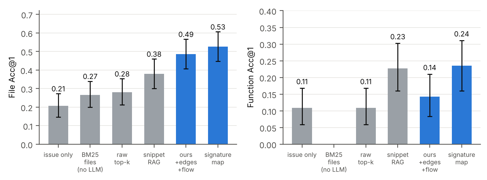
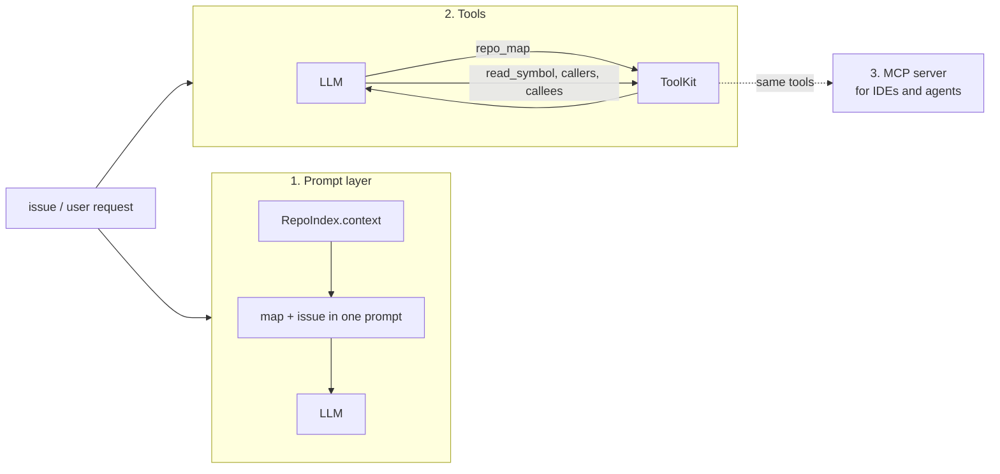
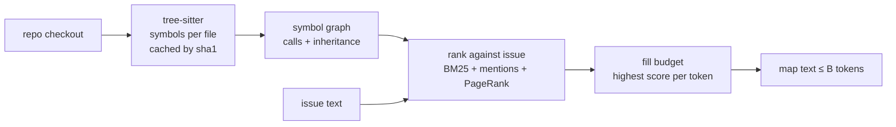

# astgraph

Budgeted repository maps for small local models. Point it at a Python repo and an issue, get back a few hundred to a few thousand tokens of ranked file paths and signatures that fit in the prompt. Built and measured for **Gemma 4 E4B on a single T4**, for the *Gemma 4 Developer Agent* paper track.

```text
$ astgraph map networkx/ --issue "pagerank does not converge for dangling nodes, see pagerank_alg.py" --budget 160
algorithms/link_analysis/pagerank_alg.py
  f def _pagerank_numpy( G, alpha=0.85, personalization=None, weight="weight", dangling=None ) L277-361
algorithms/link_analysis/tests/test_pagerank.py
  m def test_pagerank(self, alg) L63-72
  m def test_dangling_matrix(self) L141-158
  m def test_dangling_pagerank(self, alg) L161-164
  m def test_empty(self) L166-171
  m def test_dangling_scipy_pagerank(self) L206-209
classes/graph.py
  C class Graph L70-2052
utils/decorators.py
  f def _not_implemented_for(g) L83-89
classes/function.py
  f def nodes(G) L53-58
```
(Real output on the networkx source with a deliberately tiny 160-token budget. The estimated token counter was used.)

Paper: [`paper/main.pdf`](paper/main.pdf) · Technical docs: [`docs/`](docs/) · Results: [`results/`](results/)

## What it gets you

Issue localization on SWE-bench Lite, Gemma 4 E4B (4-bit), 150 test issues, same 2k-token context budget for every method:

| Context given to the model | File Acc@1 | Function Acc@1 |
|---|---|---|
| issue text only | 0.207 | 0.109 |
| BM25 over files (no LLM) | 0.267 | n/a |
| raw top-k files | 0.280 | 0.109 |
| function-snippet RAG | 0.380 | 0.227 |
| **signature map (default)** | **0.527** | **0.235** |
| signature map + call edges + control flow | 0.487 | 0.143 |

Read this honestly: the map helps a lot for **finding the file**. For finding the **function**, snippet RAG is just as good, and adding call edges and control-flow counts to the prompt made things worse, so they are off by default. A two-stage prompt (map, then re-map restricted to the model's candidate files) was the only thing that lifted function accuracy (0.04 to 0.23 on the 60-instance ablation set). Intervals are wide at this sample size; see the [paper](paper/main.pdf) and [`docs/benchmark.md`](docs/benchmark.md).



## Install

```bash
git clone https://github.com/maroofiums/astgraph-gemma && cd astgraph-gemma
pip install -e .            # tree-sitter, tree-sitter-python, networkx
```

## Use it

**Command line**

```bash
astgraph map path/to/repo --issue "TypeError in Parser.parse_date for empty input" --budget 2048
astgraph map path/to/repo --issue @issue.txt --budget 1024 --tokenizer google/gemma-4-E4B-it
astgraph stats path/to/repo
```

**Python**

```python
from astgraph import RepoIndex, hf_counter

idx = RepoIndex.from_path("path/to/repo")              # parse once
ctx = idx.context(issue_text, budget=2048)             # ranked map, always <= budget
prompt = f"REPOSITORY MAP\n{ctx.text}\n\nISSUE\n{issue_text}"
```

The default token counter is an estimate (about 3.5 characters per token). If the budget has to be exact, pass `count=hf_counter("google/gemma-4-E4B-it")`.

## Three ways to plug it into a project



| Mode | When to use it | Status |
|---|---|---|
| **1. Prompt layer** ([`integrations/prompt_layer.py`](integrations/prompt_layer.py)) | Any runtime, one model call, tight latency. Put the layer in front of the model. | Benchmarked. This is what the numbers above measure. |
| **2. Tools** ([`integrations/tool_calling.py`](integrations/tool_calling.py)) | The model drives: asks for the map, reads only the symbols it picks, follows callers/callees. Where function-level accuracy should improve. | Tool layer and loop unit-tested with a scripted model. **Not yet benchmarked with Gemma 4.** |
| **3. MCP server** ([`integrations/mcp_server.py`](integrations/mcp_server.py)) | Expose the same tools to any MCP client. | Registers and lists tools in tests (mcp 2.x). |

Longer notes, a test plan for mode 2, and other ideas: [`docs/integration.md`](docs/integration.md).

## How it works



Rankers: `bm25`, `ppr`, `bm25m`, `hybrid` (default). The default was picked on a dev split by checking how often the gold file and function end up in the prompt, without running the LLM. Details in [`docs/method.md`](docs/method.md).

## One thing worth knowing about memory

On this model, a long prompt is expensive mostly because of logits and activations, not the KV cache (the cache is under 20% of the extra memory at any length we tested). Chunked prefill with last-token logits was the difference between an 8k prompt fitting on a T4 and not. Numbers and the probe code are in [`docs/memory.md`](docs/memory.md).

## Repository layout

```
src/astgraph/    parser, graph, ranking, render, RepoIndex, tools, CLI
integrations/    prompt layer, tool-calling loop, MCP server
bench/           benchmark harness (SWE-bench Lite, baselines, report, stats)
notebooks/       benchmark_v3.ipynb (full run), kaggle_writeup.ipynb (paper-track notebook)
results/         run_v3.jsonl and the CSV/PNG outputs behind every table
paper/           main.tex, main.pdf, figure script
docs/            architecture, method, benchmark, memory, integration, reproduce
tests/           unit tests and an end-to-end smoke test with a mock LLM
```

## Reproduce

```bash
pip install -e ".[dev]" && pytest                      # 16 tests, no GPU, no network
pip install -r requirements-bench.txt                  # then run notebooks/benchmark_v3.ipynb on a T4
python paper/make_figs.py                              # regenerate figures from results/
```

The full benchmark takes about 4 to 5 hours on a T4. See [`docs/reproduce.md`](docs/reproduce.md).

## Limits

Python only. One model, one seed, greedy decoding. Localization only: no patch generation, so these numbers are not resolve rates. Call edges are matched by name and can be wrong. The "signature map" baseline is our own approximation of an Aider-style map, not Aider.

## Cite

See [`CITATION.cff`](CITATION.cff). MIT licensed.
