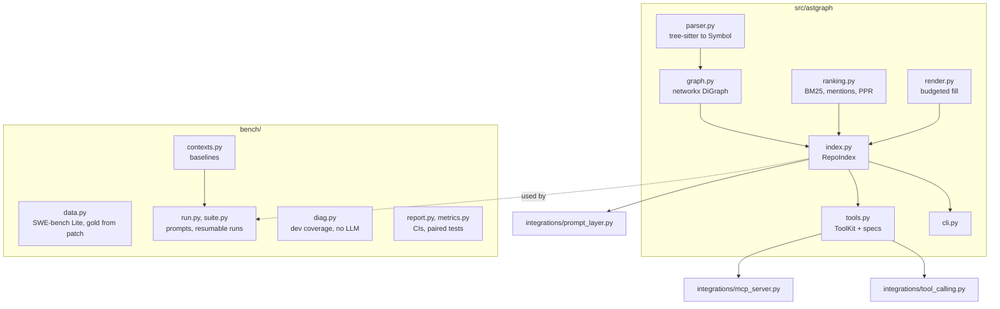

# Architecture

**Library vs benchmark.** `src/astgraph` is what you import in a project. `bench/` is the measurement harness: dataset loading, the baselines (BM25 over files, raw top-k files, function-snippet RAG), prompts, the resumable runner and the statistics. The benchmark imports the library; the library never imports the benchmark.

**Data model.** `Symbol` holds `qualname`, `kind` (`class|function|method`), `file`, `start`/`end` line, `signature`, `calls` (set of callee names), `control` (counts per statement kind) and `bases`. A node id is `qualname@file`. Edges are `calls` (weight 1/#candidates with that leaf name) and `inherits`.

**Caching.** `extract_repo(root, cache=dict)` keys parsed files by `(relative path, sha1)`. Re-indexing after a commit only parses changed files. The token cost of each rendered symbol is cached on the symbol, keyed by format, flags and the identity of the counter function, so use one counter object per index.

**Equivalence with the benchmark code.** The library was split out of the original v3 benchmark package (`contexts.py`). Before releasing, rendered maps and rankings were compared old vs new on the networkx source for 3 issues x 7 methods x 2 budgets plus all four rankers: identical text, file order and token counts (raw scores differ in the last floating-point digit between processes because of set iteration order).
