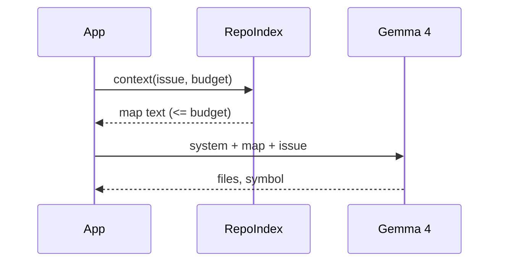
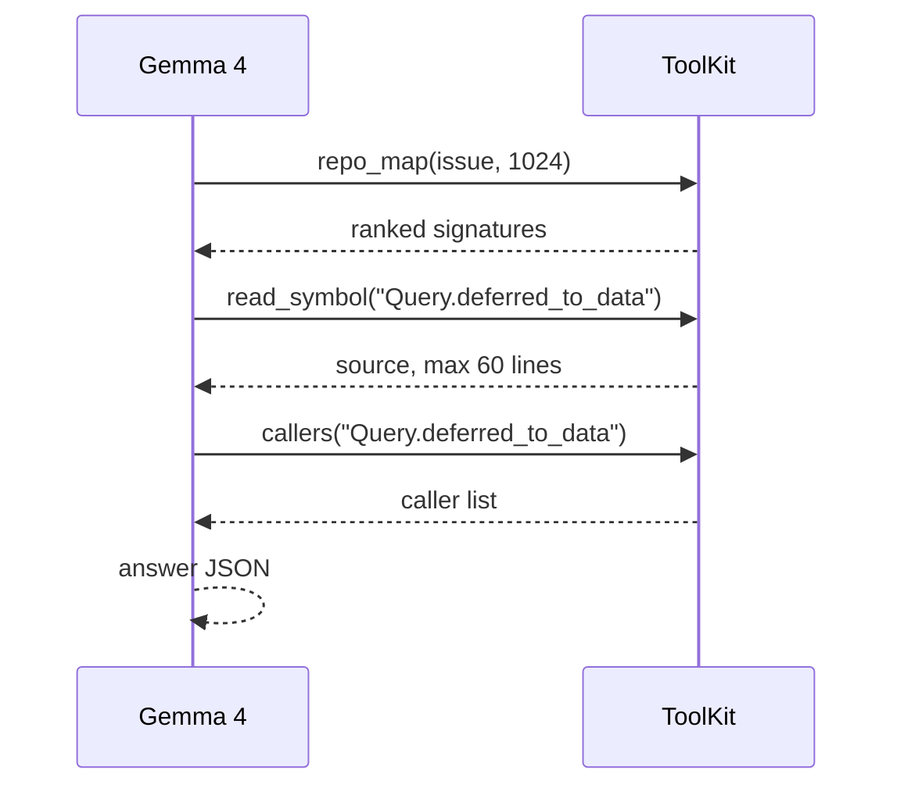

# Integration modes and ideas

## Mode 1: prompt layer (measured)

Cheapest to adopt, one model call, works with any runtime. Keep the index alive across issues (it caches parses by file hash), pass a real tokenizer counter if the budget must be exact, and put the map before the issue as in the benchmark. Use `restrict_files` for a second pass over candidate files (that is the two-stage variant).

## Mode 2: LLM calls the index as tools (not yet measured)

Why we expect this to help: the benchmark says signatures are enough to find the file, bodies are needed for the function, edges are useless as prompt text but natural as a query. In tool mode each of those is used for what it is good at.

Why it might not: a 4B model can loop, call tools with bad arguments, or answer before looking. Tool results also add tokens turn by turn.

**Experiment to run (about 2 hours on a T4 for 60 instances):**
1. Same 60 ablation instances, same gold, same metrics.
2. Arms: prompt-layer `repomap_sig` (2048), two-stage, tool mode with max 6 steps.
3. Log per instance: steps used, tokens read via tools, invalid tool calls, final accuracy.
4. Native tool calling through Ollama/vLLM/llama.cpp if the runtime supports Gemma 4 tools, otherwise the JSON-in-text path in `integrations/tool_calling.py` (`parse_tool_call`).

Tool outputs are capped (`ToolKit(max_chars=4000, max_items=15)`), ambiguous names return a disambiguation list instead of guessing, and errors come back as text so the loop keeps running.

## Mode 3: MCP server

`python integrations/mcp_server.py /path/to/repo` serves the same six tools. Tested with mcp 2.3 (`MCPServer`); the file falls back to `FastMCP` for mcp 1.x, which has not been tested here.

## Other ideas, in the order I would try them

1. **Map for files, snippets for functions.** The two methods win different things (map: file localization; snippet RAG: function level). Use the map to pick the top 3 files, then run snippet retrieval inside only those files. This is a direct test of "where do the two methods complement each other" and needs no new components. Untested.
2. **Incremental index behind a file watcher or git hook.** Parsing is cached by sha1, so a daemon can keep the index warm. Ingest was the largest fixed cost in the benchmark (median 4.7 s, p95 15.9 s with a cold-ish cache on Django/SymPy-sized repos), so this matters for interactive use.
3. **Repository-level static map plus a dynamic tail.** Build a query-independent map (ranked by PageRank only) once, cache its KV prefix, and append the issue and a small query-specific map. We did not measure this; the benchmark map is query-dependent and so is not prefix-cacheable.
4. **Fallback when the ranker is unsure.** The failure analysis says the model never recovers if the gold file is absent. A cheap check (BM25 file recall disagreeing with symbol ranking) could trigger a larger budget for just those issues, since the budget sweep shows map accuracy is flat in size but coverage is not.
5. **Other languages.** Add a tree-sitter grammar and a node-type table per language. Only the parser changes.
6. **Chunked prefill by default** for any local runtime that allows it (see `docs/memory.md`).
